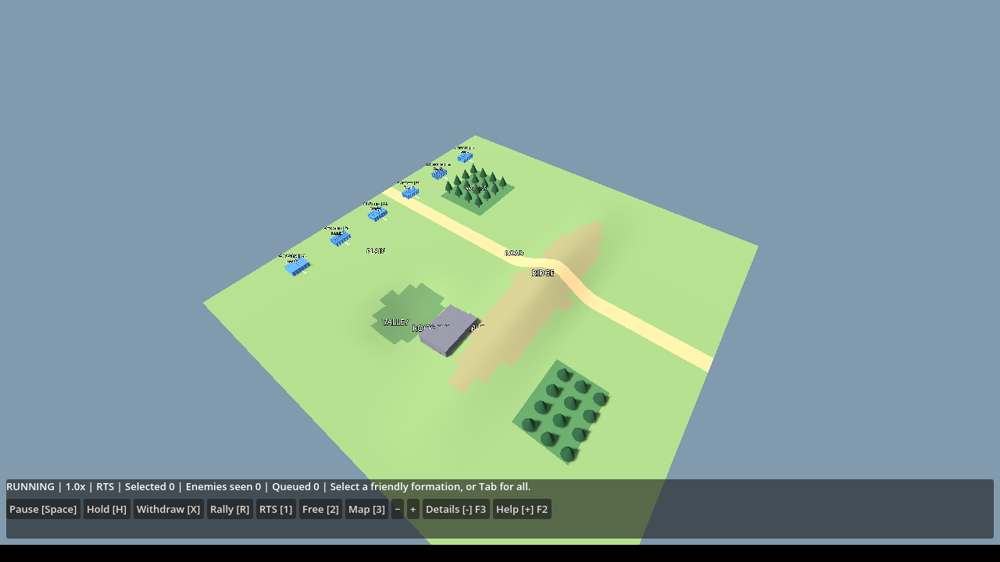
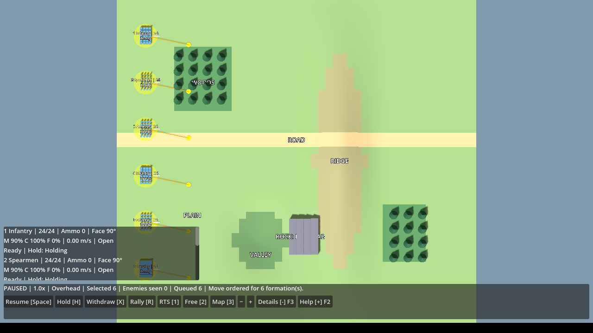
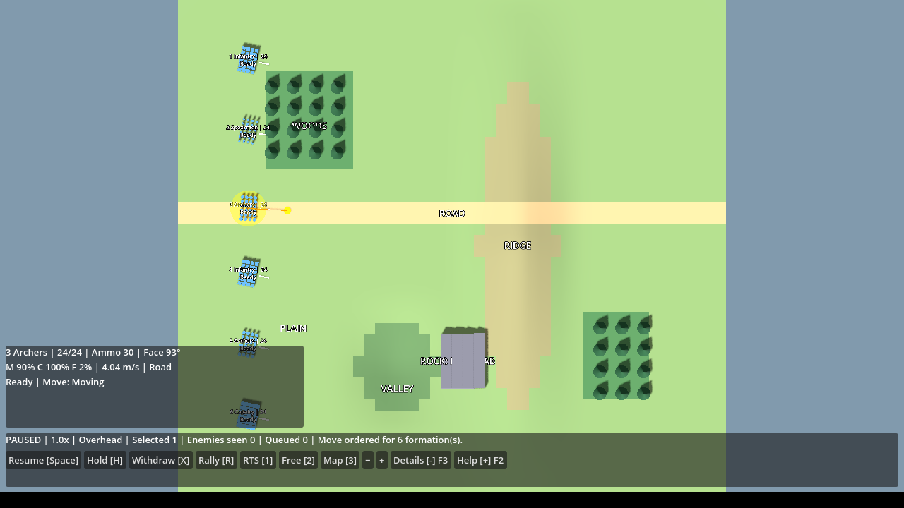
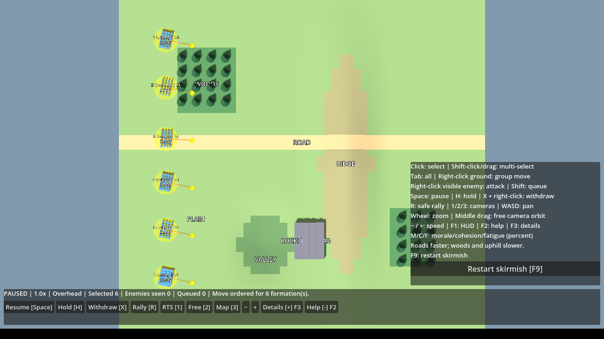
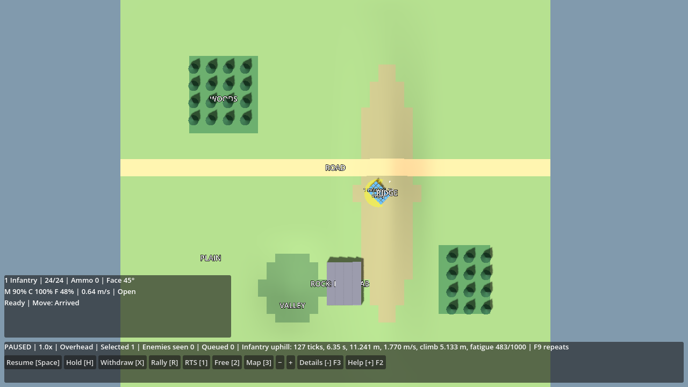

# Gate 1 corrections: HUD and terrain

Gate 1 remains **open** for native Windows acceptance. These changes address the two reported defects only. Troop identification/model construction, all 44 original simulation checks and both original engine suites are preserved. No Gate 2 systems were added.

## What changed and why

The persistent HUD is now a 76-pixel bottom strip (10.6% of a 720px viewport), containing battle status and working command/camera/pause buttons. Selected formations alone have a 422×116px detail panel at the lower left, with scrolling for groups and F3 collapse. Help is closed by default and opens at the lower right with F2. F1 still hides/shows the whole HUD; F9 still restarts. Buttons do not take keyboard focus. Center picking and all prior shortcuts remain available. Details show actual last-tick speed and terrain, alongside strength, ammo, facing, orders and morale/cohesion/fatigue.

Terrain penalties existed, but had concrete integration gaps: clear paths bypassed terrain-cost routing; A* evaluated slope in the reverse direction; collision-only smoothing erased cheaper terrain routes; uphill travel added no extra fatigue; per-vertex colours blended across terrain classification boundaries. Corrected eight-neighbour A* integrates forward surface/slope cost in 0.5m samples with stable tie breaking, considers cheaper road/forest detours even when the direct line is clear, and smooths only without increasing cost. Circular rock/map clearance remains authoritative.

Forest base movement is 65% for infantry/spears/archers, 35% for cavalry; road is 120%, open 100%. Uphill multiplies this by a grade-dependent factor (cavalry and spears incur greater slope penalties); downhill has a smaller penalty. An approximately 68% grade on the playable ridge cuts infantry movement below 50%; slopes above 80% are impassable. Movement adds base fatigue plus rounded-up uphill grade/200 effort each fixed tick. Forest cohesion and all existing combat/morale/AI rules remain.

Each rendered cell now has its simulation cell's exact ground classification colour. Mesh and collision heights use the same corner heights and triangular interpolation as simulation queries. Trees still derive from forest cells. Tests read all 15,000 mesh vertex colours and actual terrain collision raycasts. Troop models and their ID/class labels were not changed.

## Measured playable-map movement

Fresh single formation, fatigue 0, seed 42, 20 fixed ticks/second, default skirmish terrain and unit definitions. Enemies/combat/AI are disabled only in these isolated measurement fixtures to remove traffic and combat effects. Commands go through terrain raycasts and the existing playable input adapter; ordinary `_Process` advances the same simulation. Time is simulation time; at 1x it approximately matches wall time, subject to rendering stalls. Average speed uses actual horizontal distance, not endpoint displacement.

| Trial | Start → end (metres, X/Z) | Path distance | Time | Average speed | Final fatigue /1000 |
|---|---|---:|---:|---:|---:|
| Infantry open | (-32,-38) → (-20,-38) | 12.000m | 3.05s | 3.934m/s | 61 |
| Infantry forest | (-32,-24) → (-20,-24) | 12.000m | 4.80s | 2.500m/s | 192 |
| Cavalry open | (-32,-38) → (-20,-38) | 12.000m | 1.90s | 6.316m/s | 38 |
| Cavalry forest | (-32,-24) → (-20,-24) | 12.000m | 5.55s | 2.162m/s | 222 |
| Infantry level | (-40,0) → (-32,0) | 8.000m | 2.05s | 3.902m/s | 41 |
| Infantry uphill | (2,0) → (10,0) | 11.241m | 6.35s | 1.770m/s | 483 |
| Infantry road | (-32,-6) → (-20,-6) | 12.000m | 2.55s | 4.706m/s | 51 |

The uphill endpoint is 5.133m higher; both hill/level endpoints are 8m apart, but routing chooses an 11.241m gentler detour uphill. Its travel time therefore includes both slope penalty and the longer route. Separate direction/class/slope-cost tests verify the speed penalty directly. Fatigue and short final arrival steps explain differences from nominal base speed.

`Terrain-Trials.cmd` in the ZIP offers all seven **visible** runs. Choose 0–6, then press Space in the game. The trial starts selected and paused with the path queued, pauses on arrival and reports its measured result (hover the status line for its full tooltip). F9 repeats. Avoid changing orders during a comparison. `Verify-Gate1.cmd /nopause` automatically runs the same seven cases headlessly and writes fresh measurement logs.

Arrival tick, travelled distance and arrival fatigue are recorded by the fixed-tick simulation, so measurements remain correct when several ticks occur in one rendered frame. This is diagnostic output from the authoritative movement state, not a second movement model.

## Verification and honest failures

Source: `source tools/cloud-env.sh; bash tools/verify.sh`. Frozen restores, build with zero warnings/errors, **55/55 simulation tests**, both original engine suites, new HUD/render integration and all seven playable terrain runs passed. Original 44 test bodies, original engine suite bodies, and formation model/ID construction were checked against the previous commit; no original assertion was weakened.

New 11 tests cover the playable map's infantry/cavalry forest penalties, uphill speed/fatigue, road benefit, repeatability, frame partition independence, arrival diagnostics during long frames, all four classes, cheaper forest detours, nearby road routing, direction-sensitive cost and steep blocking. HUD integration checks selected-only/collapsible panels, compact bounds, center clearance, no button keyboard focus, pause/resume/hold buttons, terrain orders and cameras. Both original suites continue to verify click/shift/box selection, live orders, group queue/resume, withdraw/rally and hidden enemy picking boundaries.

Failures found during development were corrected, not suppressed:

- Initial HUD build used an unsupported Godot theme property and a distance type shadowed by Node3D.Position; replaced with supported theme APIs and qualified simulation distance.
- A rendered uphill trial initially failed its distance comparison: frame-level position sampling undercounted waypoint corners when multiple ticks ran per frame. Distance/arrival diagnostics now originate in fixed ticks; an extra one-second-frame regression protects this case.
- Wine rendering lacked the triangle glyphs used on collapse buttons; changed them to plain +/- indicators for reliable legibility.
- The first preservation-check script mishandled separator whitespace between unchanged methods; corrected the comparison. It was not a gameplay/test assertion failure.

Final source/export verification passed with zero warnings/errors. Fresh extracted Windows ZIP execution of `Verify-Gate1.cmd /nopause` under Wine exited **0**: **55 passed, 0 failed**, both original exported-engine suites PASS, corrections integration PASS, seven playable terrain trials PASS with exactly the tabled measurements. The isolated Wine prefix has no installed Windows .NET runtime; multilevel lookup was disabled, so bundled apphosts/runtime and the game’s exact Simulation.dll were exercised.

Source logs: [source and export verification](corrections-evidence/source-verification.log), [Windows verification](corrections-evidence/windows-verification.log), [Gate 0 engine](corrections-evidence/gate0-smoke.log), [Gate 1 engine](corrections-evidence/gate1-smoke.log), [HUD/terrain engine](corrections-evidence/corrections-smoke.log). Default skirmish regression still generated 92 casualties and 242 commander decisions by tick 3200; surprise replanning remains Exploit@1 → AvoidSpears@81.

Actual rendered Windows executable under Wine/Mesa, with XTest OS mouse/keyboard input: single archer selection, six-unit group order on playable terrain, tactical pause/resume, RTS/free/overhead cameras, selected details, help and collapse were observed. Paused screenshots have **zero changed pixels**, six selected units and six queued orders; resume shows moved positions and queued count 0. The final rendered Windows uphill trial also reported exactly 127 ticks / 6.35s / 11.241m / fatigue 483. Button signal dispatch/pause/hold/focus checks are separately asserted in the exported HUD suite. Screenshots are actual executable output, not UI mockups.

ZIP: `packages/Fantasy-Warfare-Gate1-Windows-x64.zip`, **70,825,407 bytes**. SHA-256: `821863d6527670d492b175b2598eb1c35fc17b391b9987b195c1da07b87e7e84`. ZIP CRC, all **201 bundled file hashes**, all **26 gameplay/source hashes** and self-contained Windows x64 PE/.NET configuration verified after fresh extraction. Source commit in its manifest: `8f9d4e9eac61f36cc3c9fd46591cba75e3aefd64`; later delivery commits contain the archive/evidence/documentation only.

## Limits and next acceptance steps

Windows binaries tested through Wine are compatibility-layer evidence, **not native Windows/GPU acceptance**. Native testing is still required. Windows 10/11 x64, OpenGL 3.3 driver; unsigned portable build. Godot and .NET runtime dependencies are bundled; neither development tool needs installing.

Static 2m routing approximates minimum travel cost and can still congest against moving formations. Group pace caps do not guarantee rigid formation spacing across different terrain. Surface penalties use formation center classification; circular clearance applies to obstacles. Very small resized windows may require expanding the window to access the entire command row; default 1280×720 was tested. Terrain is authored, not imported. No historical calibration or large-army performance claim.

Next: extract this updated ZIP, run verification, then test battlefield visibility, selected details/help, commands and all cameras; compare the included visible terrain trials and ordinary skirmish movement. Gate 1 stays open until the user accepts both fixes natively. Do not begin Gate 2.

