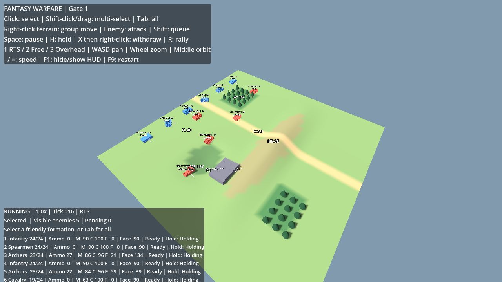
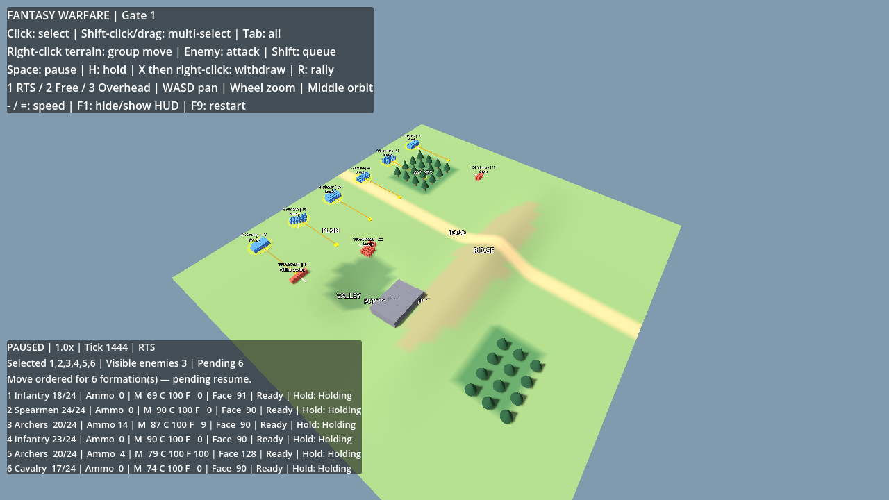
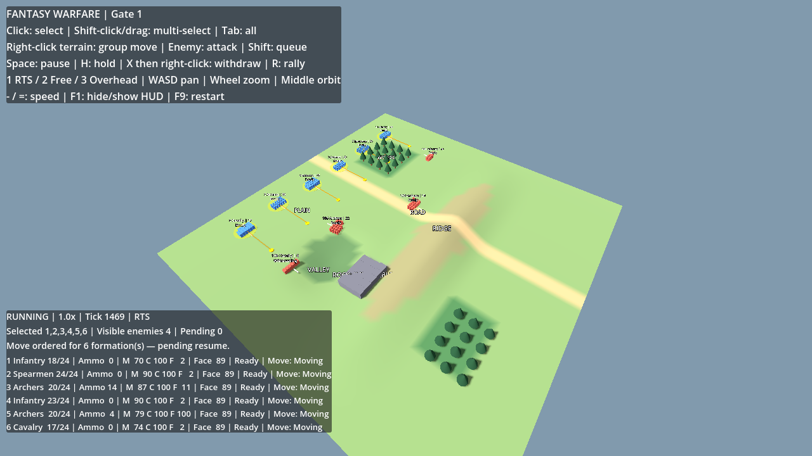
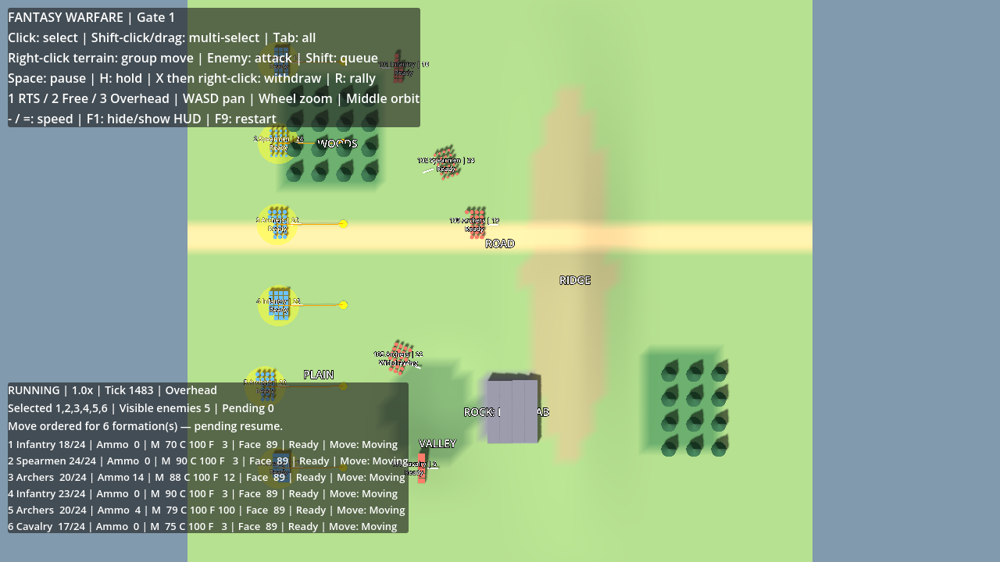
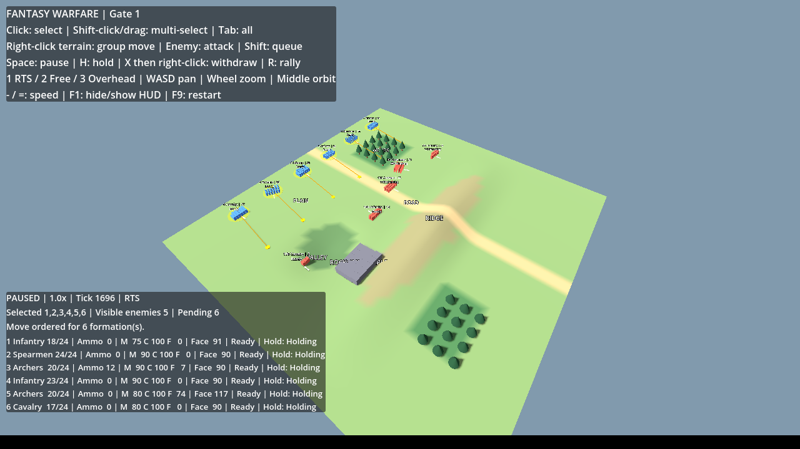
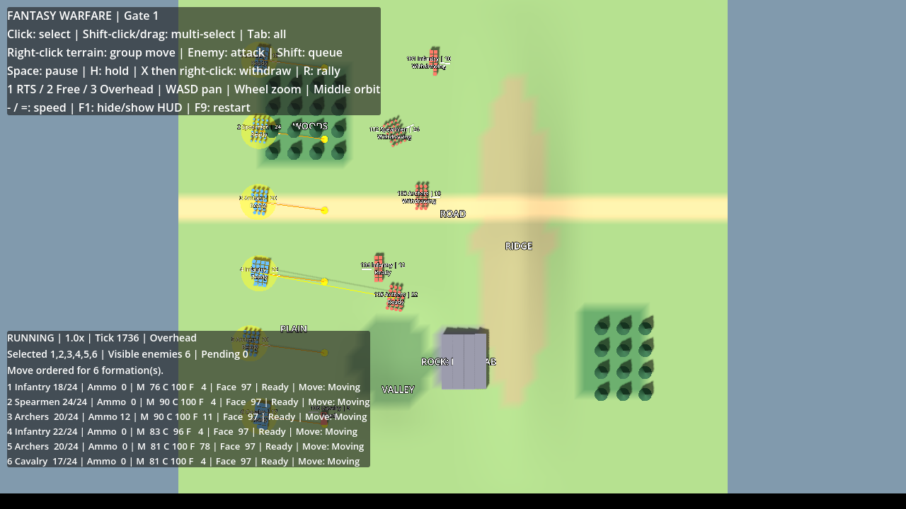

# Initial Gate 1 delivery validation record

This is the historical initial delivery record. For the current HUD/terrain correction package, 55-test results and measured travel times, see [Gate 1 corrections](GATE1_CORRECTIONS.md).

Gate 0 native Windows user acceptance passed, as reported by the user. Gate 1 tests below were executed in Linux / Wine; they do not substitute for native Windows/GPU testing.

## Current source and scenarios

Toolchain: .NET SDK 8.0.426, Godot 4.6.3 .NET; Windows export includes .NET 8.0.32. `bash tools/verify.sh` uses frozen restores and real runner exit status. The final source build has zero warnings/errors, 44/44 simulation checks, original engine regression PASS and tactical engine integration PASS. Final export repeats this workflow; package results are recorded below.

All eight original Gate 0 assertions remain. New checks exercise movement, static footprint routing/terrain, combat, ammo, morale/cohesion/fatigue, selection, knowledge and commander behavior. Reproducible surprise: Exploit@1 → AvoidSpears@81 after reserve 2 becomes observed; an actual withdrawal order is received. Mixed combat fixture: 28 casualties, 10 decisions, RNG state 730922798; complete outcomes/events/decision traces match 10ms, 50ms and 125ms frame partitions. Default 12-formation skirmish: 100 casualties, 254 decisions by tick 3200 (160 simulated seconds), ongoing battle. These are scenario outcomes, not performance/calibration claims.

## Commands executed

```bash
source tools/cloud-env.sh
dotnet build game/FantasyWarfare.csproj
dotnet run --project tests/Simulation.Tests
bash tools/verify.sh
"$GODOT" --headless --editor --path game --import
"$GODOT" --headless --path game --fixed-fps 20 -- --smoke
"$GODOT" --headless --path game --fixed-fps 20 -- --gate1-smoke
bash tools/export-windows.sh
```

The export script runs `dotnet publish ... -c ExportRelease -r win-x64 --self-contained true` and Godot `--export-release "Windows x64"`. It packages the test apphost/DLL/config next to the **game's** exact Simulation.dll/runtime, includes licenses, verifies Windows x64 PE/self-contained runtime configuration, creates per-file/source SHA-256 manifest and ZIP CRC check. Export template SHA-512 is verified against the official pinned release checksum. No signature/checksum/TLS verification is disabled.

Rendered source checks used an isolated Xorg dummy display/Mesa llvmpipe and real XTest mouse/keyboard events (`python3 /tmp/gate1-input.py`). Select-all, paused terrain group order, resume and camera keys were exercised; screenshots inspected. Paused captures have zero changed pixels, tick 1444, six selected units and six pending orders. After resume: tick 1469, pending 0, current Move orders and changed positions. Combat screenshot shows real missing strength/ammo and visible enemy formations. These are actual runtime captures, not mockups.

## Failed checks investigated and corrected

- A Godot Label theme property did not exist: compile failed. Replaced with supported theme APIs; subsequent builds have zero errors/warnings.
- The original engine paused-order assertion failed (2 pending rather than 3) at an exact flat-trimesh vertex. Terrain picking now retries within a quarter pixel after a missed ray; the original assertion is retained and passes.
- The default skirmish originally generated zero casualties despite isolated combat tests passing. Commander staging stopped outside its 30m threat filter. Corrected public scouting progression and contact-range evaluation; added a real default-skirmish combat regression, now producing 100 casualties without omniscient target coordinates.
- Added a forest-contact case to ensure center LOS does not prevent actual rank-contact melee inside woods. Contact sensor/clear-ground melee semantics are tested; distant blocked arrows remain blocked.
- Initial headless box-selection check chose an extra unit because Godot's headless viewport was 64 pixels wide. Set smoke fixtures to gameplay's logical 1280x720 viewport; retained actual drag threshold and box-selection assertions, now passing.
- Victory-state commands were accepted but could not execute after the battle froze. Commands now return a clear restart error; the victory regression checks that rejection.

Final passes do not erase those initial failures; each prompted a concrete correction/test. No failed assertions were disabled, marked expected, or replaced by compile-only checks.

## Known limits and acceptance

Static 2m grid/circular footprints plus local sidestep handling can congest in crowded dynamic passages. Group common pace does not enforce rigid arrival timing. Terrain-aware detours are not a global crowd/fastest-road optimizer. Facing is instantaneous. Formation salvos resolve immediately; no individual soldier or projectile physics. Morale/combat numbers are configurable initial abstractions, not calibrated history. Sensor rules share contacts immediately, use fixed ranges/eye height and expire stale reports after 10s; no probabilistic detection/weather/night model. Baseline rule/utility commander is demonstrated in scenarios, not claimed generally superior. No save/load or large-army benchmark.

Only Gate 1 tactical scope is present. Native Windows/GPU testing of this new package is pending. Run the included Verify-Gate1.cmd, then manually test group movement/traffic, terrain, combat, morale/withdraw/rally, fog and all cameras before more features.






## Final extracted Windows package

Final SHA-256, extraction and actual exported Windows test results are appended after verification; do not infer native Windows acceptance from Wine.

Final executable ZIP: 70,812,028 bytes; SHA-256 `5eb7d66af6ac72ccdc99e2f60ec576101e77e3760e287f04beb2b53f4c48cd34`. Fresh extraction verified all 200 manifested hashes. The Windows Wine prefix has no installed Windows .NET runtime; bundled test/game executables are run with global multilevel lookup disabled. The no-SDK verification command tests the game's exact simulation DLL and both exported-engine suites.

Rendered extracted Windows executable used Wine/Mesa and actual keyboard/mouse inputs. Paused captures are pixel-identical: tick 1696, six selected formations and six pending orders. Resume capture: tick 1718, pending zero and moving positions. This is compatibility-layer evidence, not native Windows acceptance.

The final verification helper rejects every nonzero exit (including negative crash codes) and refuses undeletable stale logs. Original eight Gate 0 test bodies were checked byte-for-byte against the original commit; all eight are retained.

Final extracted package execution: `wine64 cmd /c "...\Verify-Gate1.cmd /nopause"` exited **0**, with **44 passed / 0 failed**, original exported-engine regression **PASS**, tactical exported-engine suite **PASS**. The tested source commit recorded inside the package is `d5a7cfbe80a5cff7a5593dfd23d11c7c7767dfc5`; subsequent commits contain delivery/documentation only. The final archive is the one copied to `packages/Fantasy-Warfare-Gate1-Windows-x64.zip`.




