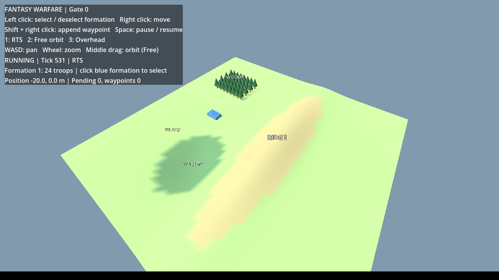
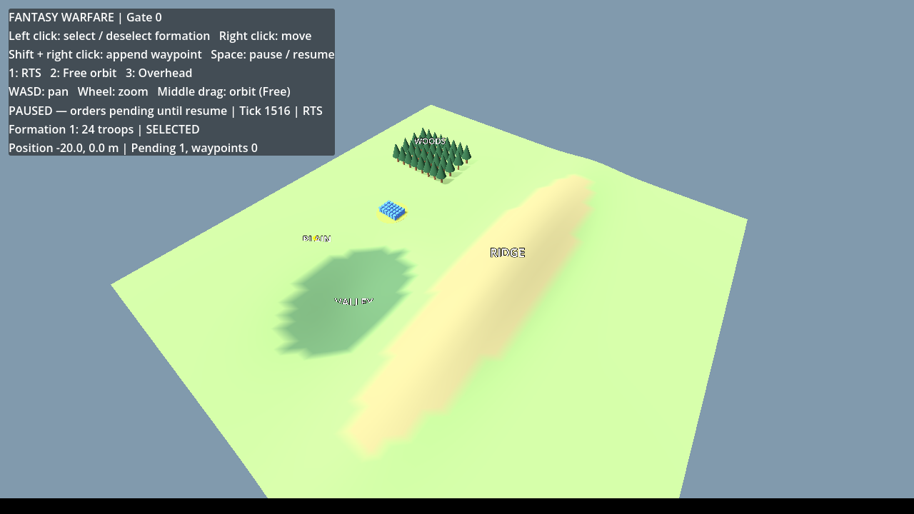
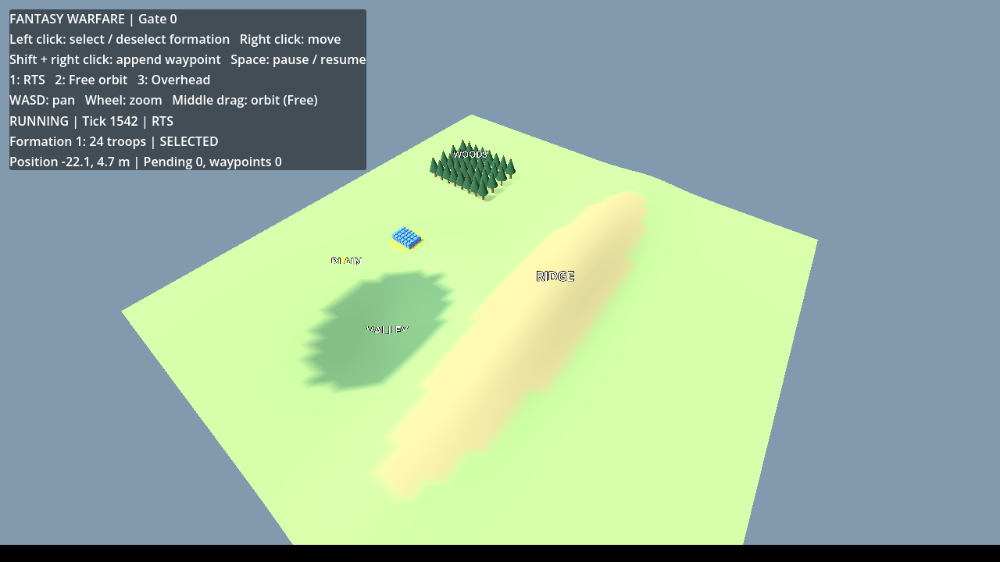
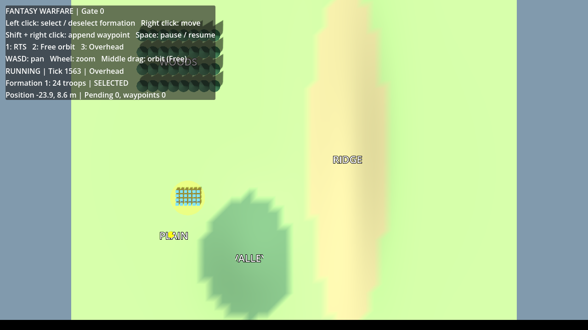

> Historical Gate 0 packaging record. The user subsequently confirmed native Windows Gate 0 acceptance. Current Gate 1 package/results are in [GATE1_VALIDATION.md](GATE1_VALIDATION.md).

# Gate 0 self-contained Windows x64 package

## Player download and launch

[Download the executable ZIP](https://github.com/kwgeologist/Fantasy-Warfare/blob/main/packages/Fantasy-Warfare-Gate0-Windows-x64.zip?raw=true).
Extract **all** files, then double-click `FantasyWarfare.exe`. Keep its `.pck` and data directory in place. The source repository's **Code → Download ZIP** is a source archive; this linked package is the runnable build.

Requirements: Windows 10/11 x64 and an OpenGL 3.3-capable graphics driver. Includes Godot 4.6.3 .NET release engine, .NET 8.0.32 host/CoreCLR/framework libraries, game and simulation DLLs, original test harness and licenses. No editor, SDK, separate .NET Runtime, paid service or external game assets are needed. Native imports use Windows system/UCRT libraries, so no separate Visual C++ Redistributable is required. Hardware-specific graphics drivers and Windows system libraries are OS/vendor prerequisites. This is an unsigned portable test build; Windows can display an unknown-publisher/SmartScreen notice. ARM64 and 32-bit builds are not included.

`Verify-Gate0.cmd` runs the original eight mechanic tests against the packaged game's `Simulation.dll`, then the **exported game** integration assertions. It writes a fresh `gate0-smoke.log` and checks the current-run PASS marker as well as exit codes. Use `/nopause` in automation. The apphost for the harness shares the game runtime without copying a second authoritative simulation assembly or a second runtime. Normal play needs only the executable; the verification command is optional.

## Rebuild

Cloud workflow, from `/workspace/Fantasy-Warfare`:

```bash
bash tools/export-windows.sh
```

This verifies the official .NET export template archive SHA-512, revalidates the existing project, exports the release with the checked-in `game/export_presets.cfg`, publishes the unchanged tests for Windows, shares the game's runtime/Simulation.dll, adds notices, verifies package structure/self-contained runtime configuration/x64 executable, and writes `builds/Fantasy-Warfare-Gate0-Windows-x64.zip`. The package manifest records SHA-256 of source and every bundled file. The ZIP is checked for CRC integrity. Repeat builds should be functionally equivalent; byte-identical ZIPs are not claimed.

The export preset deliberately uses the existing OpenGL Compatibility renderer. No embedded build outputs, trimming, single-file .NET bundling, gameplay source changes or alternative simulation are introduced. `Directory.Build.props` redirects only ExportRelease/ExportDebug restore lockfiles into ignored `obj` paths and pins runtime 8.0.32. The original development lockfiles and tests remain unchanged. On Windows, install matching .NET/Godot development tools and templates to rebuild using the preset in Godot; this does not apply to players.

## Evidence and limitations

- `bash tools/verify.sh`: PASS — original build, 8/8 core tests, editor import and original Godot engine integration assertions.
- `"$GODOT" --headless --path game --export-release "Windows x64" .../FantasyWarfare.exe`: PASS — self-contained release export.
- `dotnet publish tests/Simulation.Tests/Simulation.Tests.csproj -c ExportRelease -r win-x64 --self-contained true -o builds/windows-tests`: PASS. Only harness-specific files are copied into the game's runtime directory; its Simulation.dll is retained.
- Exported `Simulation.Tests.exe` under Wine 10: PASS — 8/8 against the game's exact simulation DLL and bundled runtime.
- Exported `FantasyWarfare.exe --headless --fixed-fps 20 -- --smoke` under Wine 10: PASS — selection and terrain raycasts, live move/reissue, pause/queue/resume, RTS/free/overhead, orbit and zoom.
- Exported game rendered under Wine/Mesa llvmpipe with real XTest mouse/keyboard input: selection, paused order, resumption/movement and 1/2/3 camera keys exercised. Paused captures are pixel-identical; tick 1516 and position (-20.0, 0.0) remain fixed with one pending order. Resumed capture shows tick 1542, position (-22.1, 4.7), no pending order.
- Gameplay, simulation, scenes and test source match the previously tested/pushed Gate 0 commit `42525442f392e6fbfa08ed42b5976b02a7ba9e33`.

Wine used an isolated prefix with no Windows .NET SDK/runtime installation. Its Linux-side dependency setup is for validation only and is not distributed. Source checks passed, then actual Windows binaries were exercised. Compatibility-layer success is not native Windows or hardware-GPU acceptance. Native launch, actual Windows input/display scaling and GPU-driver compatibility remain for user testing. Gate 1 is not started.

Initial export restore changed the development lockfiles; those setup-generated changes were restored, then an export-only lockfile path was added and the export rerun. Initial local Wine failures came from relocated server/NLS/zlib lookup and incomplete prefix initialization; resolved in the external Wine tool directory, with no edits to game/runtime binaries. GitHub's release API is unavailable with this environment's current authentication route; the ZIP is published as a repository file through the working authenticated Git route.

## Rendered exported-build evidence






## Native Windows acceptance before Gate 1

Extract and launch; verify all four terrain features. Select/right-click and wait for an exact stop, then replace a move while running. Pause, replace and append moves, wait, and resume. Confirm positions/ticks froze while paused and orders execute on resume. Switch all cameras; test WASD, zoom and free orbit/tilt while both running and paused. Run `Verify-Gate0.cmd`. Report Windows version/GPU/driver plus any failing step and engine log. No combat, enemy AI, multiple formations or other new gameplay is present.

## Final ZIP validation

The complete `tools/export-windows.sh` run exited 0, including the source checks and export. Final ZIP: 70,756,963 bytes; SHA-256 `4d719b4191984a3bf0a7036abbc6d8d6d809e1a6d2cde7efbe9e05e61762a073`.

Extracted it afresh into `/workspace/windows-package-verification`: all 199 manifested file hashes matched. The Wine prefix had no `Program Files/dotnet` installation; `DOTNET_MULTILEVEL_LOOKUP=0` was set for the final check. The **extracted ZIP's** `Verify-Gate0.cmd /nopause` completed with exit 0, printed 8 passed / 0 failed, and verified a fresh exported-engine integration PASS marker. A PE import scan of the package found no VCRUNTIME/MSVCP/CONCRT redistributable dependency. This verifies the distributed files, not just pre-ZIP staging output.
